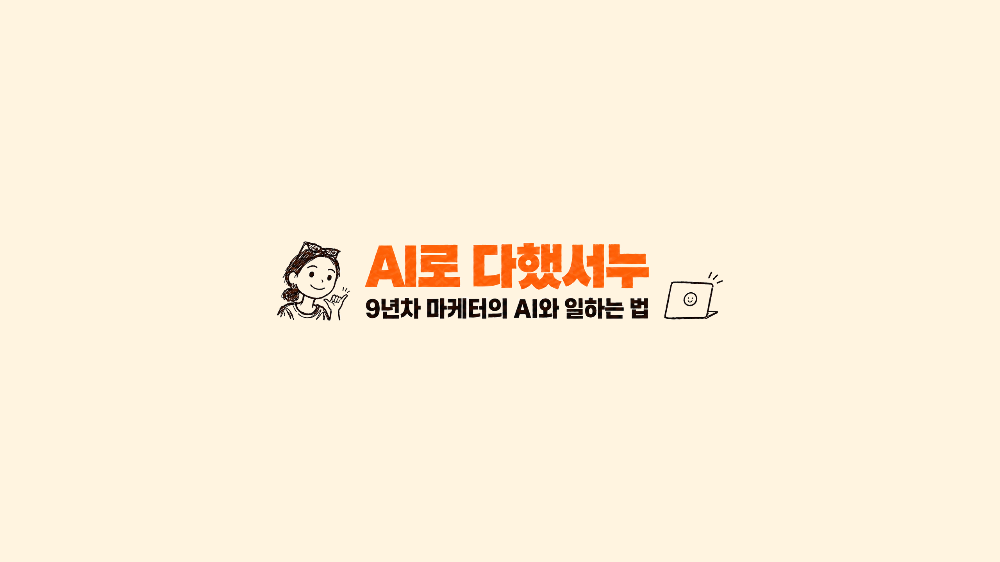

# Branding guide — 브랜딩 툴 키트 스킬

질문 5개에 생각나는 대로 답하고 로고·사진을 넣으면, **브랜드 가이드 파일 한 장(`brand-guide.md`)**과 **브랜드 보드**를 만들어 주는 Claude 스킬이에요. 가게 · 브랜드(쇼핑몰) · SNS 계정 · 퍼스널 브랜딩 모두 돼요. **클로드 무료 계정에서도 돼요.**

- `branding-guide/` — 스킬 폴더 (이 폴더를 통째로 설치해요)
- `chatgpt/chatgpt-prompt.md` — 챗GPT용 프롬프트 (챗GPT 개인 요금제는 스킬이 없어서 붙여 넣어 써요)

버전 **0.3** · 2026-11-26

## 이렇게 나와요

1. **브랜딩 아이덴티티** — 손님이 고르는 이유(골든 서클), 브랜드 페르소나, 셀링포인트 3개, 소개글 3종, 말투
2. **마케팅 전략** — 4P 표, 핵심 메시지 3개, 채널별 할 일, 4주 실행표, 콘텐츠 아이디어 5개
3. **브랜드 컬러** — 5색 HEX, 60·30·10 비율, 글자 대비 점검
4. **로고** — 있으면 쓰는 규칙, 없으면 시안 3개
5. 그림 세 장 — **브랜드 보드**, **이번 달 마케팅 카드**, 그 컬러로 만든 **인스타 게시물 시안**

전부 `brand-guide.md` 한 장으로 저장돼요. 저장해 두면 다음 작업 때 AI가 이 파일을 먼저 읽어서 같은 말투·같은 색으로 만들어요.

## 설치

### claude.ai (웹·앱, 무료 계정 가능)

1. [**branding-guide.zip 받기**](../../releases/latest/download/branding-guide.zip) (압축은 풀지 마세요)
2. 클로드 설정 → **기능**에서 **코드 실행 및 파일 생성** 켜기
3. 설정 → **스킬** → 업로드 → 받은 ZIP 올리기

### Claude Code

Claude Code에 이 문장을 그대로 붙여 넣으면 알아서 설치해요.

```
github.com/Sunwoo-choi-1/branding-guide-skill 저장소의 branding-guide 폴더를 ~/.claude/skills/branding-guide 에 설치해줘
```

직접 할 때:

```powershell
# Windows (PowerShell)
git clone https://github.com/Sunwoo-choi-1/branding-guide-skill.git $HOME\branding-guide-skill
Copy-Item -Recurse -Force $HOME\branding-guide-skill\branding-guide $HOME\.claude\skills\
```

```bash
# Mac
git clone https://github.com/Sunwoo-choi-1/branding-guide-skill.git ~/branding-guide-skill
mkdir -p ~/.claude/skills && cp -R ~/branding-guide-skill/branding-guide ~/.claude/skills/
```

설치 후 Claude Code를 껐다 켜고 `/branding-guide`를 쳐요. 업데이트는 `git pull` 후 같은 복사 명령.

### Codex

`branding-guide` 폴더를 `~/.agents/skills/`(Windows `C:\Users\<이름>\.agents\skills\`)에 넣고 Codex 재시작 → `$branding-guide`로 호출.

### 챗GPT

[`chatgpt/chatgpt-prompt.md`](chatgpt/chatgpt-prompt.md)의 회색 칸을 통째로 복사해서 새 대화에 붙여 넣어요. 저장해 두고 쓰는 법(프로젝트 + 개인 맞춤 설정)도 같은 파일에 있어요.

## 사용

```
branding-guide 스킬로 우리 가게 브랜딩 해줘
```

```
branding-guide 스킬로 내 인스타 계정 퍼스널 브랜딩 해줘
```

- 링크가 안 열리면(클로드 무료 요금제의 인스타 링크 등) AI가 화면 캡처 3장을 달라고 해요.
- 컬러 뽑기·로고 시안·브랜드 보드는 코드 실행이 켜져 있어야 그림으로 나와요.
- 내가 말하지 않은 사실(연도·수상·효능 등)은 쓰지 않고 `[정하기]`로 남겨요.

## 출처

문장과 스크립트는 AI로 다했서누가 직접 썼어요. 구성 방식은 Tribe AI의 Brand Voice 플러그인, Anthropic의 marketing 플러그인(brand-review)과 brand-guidelines 예제 스킬(모두 Apache License 2.0), 클로드 아카데미 "Create brand assets"를 참고했어요. 자세한 건 [`branding-guide/CREDITS.md`](branding-guide/CREDITS.md). 이 스킬은 Anthropic·OpenAI와 관련이 없어요.

만든 곳: **AI로 다했서누** · [sunwoo-site.vercel.app](https://sunwoo-site.vercel.app)
